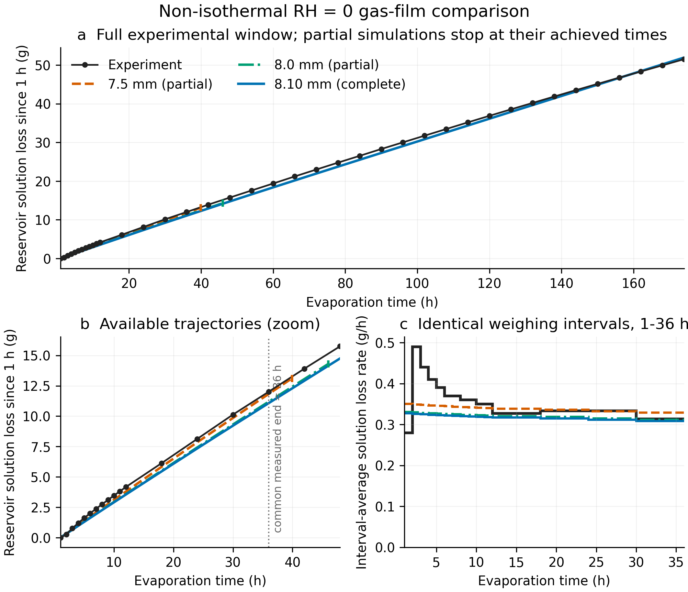

# RH=0非等温174 h与气膜厚度率定记录

本交付包补充三维圆柱RH=0非等温计算。模型固定两种砂的孔隙率和本征渗透率，以20°C作为初始、环境和储液器温度，同时求解水、盐、气相和能量传输。蒸发潜热导致模型内部温度动态降低。

## 1. 完整非等温基准：8.100162 mm

`model_revisions/20261102_cylinder_thermal_v13/`是已完成并通过数值验收的2 h预平衡+174 h蒸发结果。

- 1–174 h储液器溶液失重：51.947836 g；试验51.52 g，偏差+0.830%。
- 完整称重区间的时长加权速率RMSE：0.023923 g/h。
- 模型首次平衡固盐库存超过1e-12 mol：70.75 h；这不是试验成核时间。
- 最终固盐库存：0.226441 g。
- 174 h温度范围：18.3087–19.6756°C。
- 水、盐、两砂和能量预算均通过既定数值验收。

入口：[完整报告](model_revisions/20261102_cylinder_thermal_v13/COMPLETION_REPORT.md)、[结果摘要](model_revisions/20261102_cylinder_thermal_v13/results/summary.json)、[预算CSV](model_revisions/20261102_cylinder_thermal_v13/results/film_budget.csv)。

该8.10 mm厚度源自此前24 h等温率定，并未针对174 h结果重新拟合。总失重落入1%范围不能独立验证热边界、气膜厚度或析盐物理。固定孔隙率/渗透率下的等效固盐体积分数可超过几何孔隙容量，因此只用于库存诊断，不代表真实晶体形态。

## 2. 气膜厚度比较：7.5、8.0和8.10 mm

`analysis/film_7p5_8p0_8p1_snapshot_20261104/`保存绘图时的冻结快照：7.5和8.0 mm当时分别达到39.92和46.00 h，8.10 mm为完整174 h。部分曲线未外推。

所有模型共同覆盖的原始称重点为1–36 h。该窗口内：

| 气膜厚度 | 36 h累计误差 | 累计RMSE | 区间速率RMSE |
|---|---:|---:|---:|
| 7.5 mm（部分） | −1.529% | 0.2750 g | 0.03538 g/h |
| 8.0 mm（部分） | −6.826% | 0.5186 g | 0.04240 g/h |
| 8.10 mm（完整） | −7.820% | 0.5677 g | 0.04442 g/h |

因此只能说7.5 mm在当前共同早期窗口内更接近试验，不能据此认定其174 h表现优于8.10 mm。



## 3. 用户终止的sal计算

`model_revisions/20261103_sal_film_v16/`记录7.5和8.0 mm生产作业。用户于2026-11-04主动终止：

- 7.5 mm停止于40.5 h，储液器溶液失重13.66543 g；
- 8.0 mm停止于46.6667 h，储液器溶液失重14.84118 g。

两组均是用户停止的部分结果，不是数值失败，也不是174 h验收结果。详见[终止记录](model_revisions/20261103_sal_film_v16/USER_STOP_20261104.json)。

## 4. 代码、输入与原始归档

- v13目录包含覆盖源码、输入、门槛测试、预算和验收记录。
- v15目录保存加速求解源码、6/7 mm完整试算的清单及气膜率定方法；多GB原始场未进入GitHub。
- v16目录保存sal部署、门槛、停止与本地清理记录；运行二进制和多GB原始场未进入GitHub。

外部完整归档：

| 数据集 | SHA256 | 状态 |
|---|---|---|
| v13 8.10 mm / 174 h | `716288ecba754a483d4faa3e34fbdb0a400cb38b416272b24f4b024cde3f7ec3` | 1146个成员已验证 |
| v15 6/7 mm / 174 h | `8a526b07d8a5cb0d25ff084192d0e88cca1814bc440ff82b25f6d9e4deb6c02c` | 2233个成员已验证 |
| v16 7.5/8.0 mm停止快照 | `fca0857f0b27a3eb1a7df7276e81bf2446669517d804827e246433ef5b8ac724` | 589个成员已验证 |

这些大型归档不随Git仓库分发。`PACKAGE_MANIFEST.sha256`校验本交付包内的轻量文件：

```bash
python verify_package.py
```

## 5. 证据边界

- 气膜厚度由同一蒸发数据率定，拟合结果不能作为独立蒸发验证。
- RH与气膜厚度可相互补偿，当前结果不能识别真实样品表面湿度。
- 平衡析盐时刻不等于试验成核或MRI可见结晶时刻。
- 没有新增完整174 h网格和时间步收敛研究。
- 数值闭合与守恒是必要条件，但不是模型物理正确性的充分证据。
